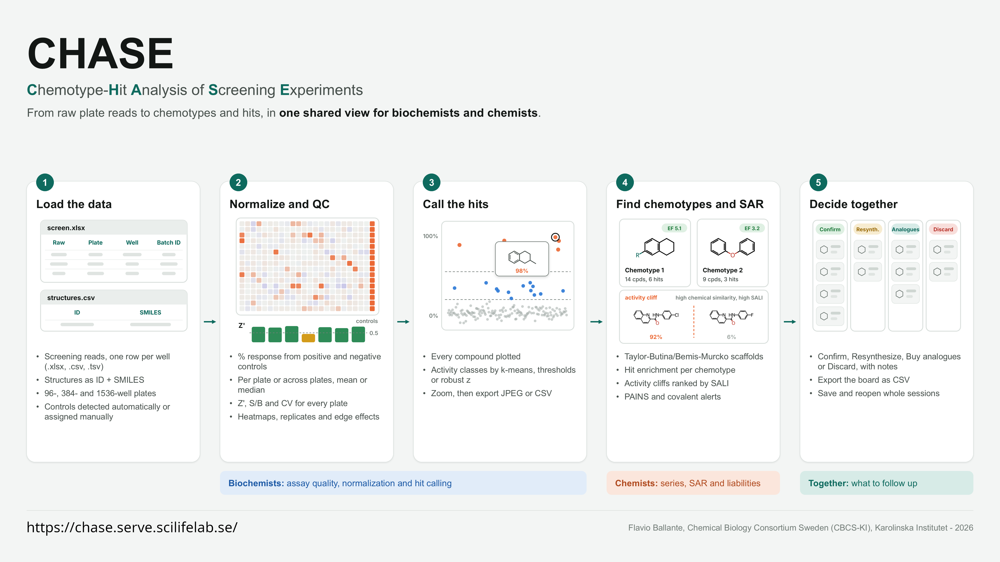

# CHASE - Chemotype-Hit Analysis of Screening Experiments


**Shiny for Python edition.** CHASE turns single-concentration screening reads into % response, plots every compound with its structure on hover, groups compounds into chemotypes, and gives biochemists and chemists a shared triage board for deciding what to follow up.

It runs locally in your browser from a conda environment. After installation it needs **no internet connection**: RDKit does all the chemistry, and the plotting library is served from the installed `plotly` package.

## Install (once)

You need [Miniforge](https://conda-forge.org/download/), Mambaforge, Anaconda or Miniconda.

```bash
cd chase-3.5.0
conda env create -f environment.yml        # or: mamba env create -f environment.yml
```

This creates an environment called `chase` with Python 3.12, RDKit, Shiny, Plotly, pandas, NumPy, SciPy, scikit-learn and openpyxl.

## Run

**Linux / macOS**

```bash
./run_chase.sh
```

**Windows:** double-click `run_chase.bat`, or run it from an Anaconda Prompt.

**Any platform, by hand:**

```bash
conda activate chase
python -m chase
```

Your browser opens CHASE at <http://localhost:8765>. Stop it with **Ctrl+C** in the terminal.

### Options

```text
python -m chase [--port 8765] [--host 127.0.0.1] [--no-browser] [--tmp DIR]
```

| Option | Meaning |
|---|---|
| `--port` | Port to listen on (default 8765). |
| `--host` | `127.0.0.1` (default) keeps CHASE private to this computer. `0.0.0.0` lets colleagues on your network open `http://<this-computer>:8765`. |
| `--no-browser` | Don't open a browser window. |
| `--tmp` | Folder for Shiny's short-lived upload copies. Default on Linux: a private folder in RAM under `/dev/shm`. |

## Nothing is stored on the server

CHASE is built to run as a shared web server without keeping anyone's data:

* **Uploads:** each uploaded file is read and its temporary copy deleted immediately. On Linux the upload folder lives in RAM (`/dev/shm/chase-<uid>-<port>`), so uploads never touch the disk; the folder is removed when CHASE stops and wiped again at the next start.
* **Sessions:** data, results, structure drawings, PAINS results and the triage board are kept in memory, per browser session, and are never shared between users. They are discarded when the tab is closed.
* **Logging:** there is no database, no data file and no request log.
* **Downloads only:** the only copies of data that leave CHASE are the files a user downloads (session, CSVs, JPEGs).
* **Browser:** each user's plot colours and name are remembered in their own browser.

## Triage decisions are never stored in a database

The triage board (Confirm / Resynthesize / Buy analogues / Discard, with notes, who and when) lives only in the open browser tab. CHASE writes nothing to disk on its own. To keep decisions:

* **Save session**: one `.json` file with data, settings and decisions, or
* **Export triage (.csv)**: the board as a table.

Load them back with **Open session** or **Import triage (.csv)**. Importing adds to the board; for a compound already decided, the newer decision wins. To work together, pass these files around. The status line above the board counts unsaved changes, and the browser warns before you close a tab with unsaved decisions.

The only things kept between visits are your plot colours and your name, stored in your own browser.

## Input files

* **Screening data** (`.xlsx`, `.xls`, `.csv`, `.tsv`): one row per well with *Raw Data*, *Plate Number*, *Well ID* and *Batch ID*. Header names are recognised automatically and can be reassigned in the app. Plate maps support 96-, 384- and 1536-well layouts.
* **Structures** (`.csv`, `.tsv`, `.smi`, `.xlsx`): one row per compound with an ID column matching the Batch IDs and a SMILES column, optionally a display name.

## What's new in 3.5.0

* **Morgan radius 3 fingerprints** (ECFP6-like, 2048 bits) instead of radius 2, for chemotype clustering and activity cliffs.

## What's new in 3.4.0

* **Server-ready privacy.** Uploaded files are deleted as soon as they are read and are kept in RAM on Linux. Caches are per session and freed when the tab closes, and requests are not logged.

## What's new in 3.3.0

* **No permanent storage of triage decisions.** The SQLite triage database is gone, and so is the option to choose its file. Decisions stay in the browser tab and are saved only to a session file or a triage CSV, which can now be imported back (**Import triage (.csv)**). Unsaved changes are counted and guarded when closing the tab; **Clear board** empties the board.
* If you ran 3.0-3.2 before, their database file `~/.chase/chase.sqlite` is no longer used; export anything you need from it with 3.2 and delete it.

## What's new in 3.2.0

* **PAINS and covalent flags.** Every compound is checked against the 480 PAINS patterns (Baell & Holloway 2010, via RDKit's FilterCatalog) and a curated list of 31 covalent warheads (acrylamides and other Michael acceptors, haloacetamides, epoxides, sulfonyl fluorides, aldehydes, boronic acids, beta-lactams, SNAr-prone arenes ...). Flags show as chips everywhere, as marks on the plot (hits only, all compounds, or off), in a *Flagged hits* tile and in both CSV exports; the compound panel names each alert and highlights the matching atoms.
* **Your own covalent list.** The warheads live in a plain text file (`chase/core/covalent_alerts.tsv`: name, SMARTS, note). Copy it to `~/.chase/covalent_alerts.tsv`, or point `CHASE_COVALENT` at a file, and CHASE uses your version.

## What's new in 3.1.0

* **Z' per plate** above the % response plot: one bar per plate, spanning that plate's compounds, coloured by quality (>= 0.5 / 0-0.5 / < 0) with a reference line at 0.5. Toggle it with *Z' per plate*.
* **Plot colours**: *Colors* opens pickers for each activity class and both control types. Your choice is remembered in the browser and saved in session files.
* **Save data (.csv)**: exports every point of the % response plot (compound number, plate, well, well type, Batch ID, name, raw, % response, compound mean, class, chemotype, plate Z', SMILES).

## Sessions

**Save session** writes a single `.json` file with both data sets, every setting, the pinned selection and the campaign's triage decisions. **Open session** restores it. Session files are interchangeable with the HTML version of CHASE (2.0).

## Tests

```bash
conda activate chase
python -m tests.test_core                                   # uses the built-in example data
python -m tests.test_core SCREEN.xlsx STRUCTURES.csv        # also checks your own files
```

## What's in the folder

```text
environment.yml      conda environment
run_chase.sh/.bat    launchers
chase/               the app (app.py = Shiny UI and server, core/ = analysis, www/ = styles and browser script)
tests/               self-checks
```

The **How to use** tab inside the app describes every feature and method, and lists the exact software versions in use.

## Acknowledgments

Thanks to Dr. Francesco Massai, Chemical Biology Consortium Sweden (CBCS-KI), Karolinska Institutet, for valuable scientific input and feedback during the development of CHASE.

---
Flavio Ballante, Chemical Biology Consortium Sweden (CBCS-KI), Karolinska Institutet - 2026 | flavio.ballante@ki.se
